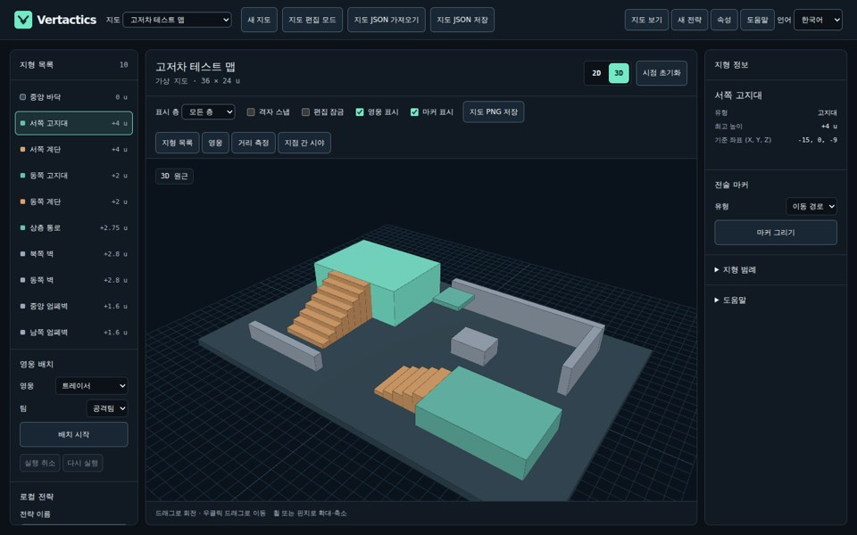

# Vertactics

[English](README.md)

**오버워치 전장을 위에서 보고, 높낮이는 3D로 확인하세요.**

Vertactics는 진입로, 엄폐물, 고지대를 살펴보고 전술을 구상하는 지도 도구입니다. **조수 중계소**에서 중앙 교량, 배수로 우회로, 상층 정비 교량을 이용한 전술을 계획할 수 있습니다.

[Vertactics 열기](https://qtaghdi.github.io/Vertactics/)

[같은 지도에서 2D 편집기 보기](docs/screenshots/workspace-2d.jpg)

## 지도 둘러보기

1. **2D**에서 드래그해 이동하며 지형 배치를 확인합니다.
2. **3D**에서 드래그해 시점을 회전하고, 우클릭 드래그로 이동하며 계단과 고지대를 살펴봅니다.
3. 지도나 목록에서 지형을 선택하면 좌표와 높이가 표시됩니다. 보기를 전환해도 지형 선택은 유지됩니다.

마우스 휠이나 핀치로 확대·축소할 수 있습니다. 시작 화면으로 돌아가려면 **시점 초기화**를 누르세요.

**지도 관리 → 전장 목록**에서 OWKR 내전 전장 31개를 살펴볼 수 있습니다. 왕의 길은 A 거점 근사 지도를 열고, 지형 데이터가 필요한 항목은 준비 중으로 표시합니다.

## 영웅 배치하기

**영웅 배치**에서 영웅과 팀을 고르고, 지도에서 바닥이나 고지대를 클릭해 배치합니다. 배치한 영웅의 위치와 방향을 바꾸거나 팀을 전환할 수 있습니다. 2D에서 놓은 영웅을 3D에서도 같은 위치와 높이에서 볼 수 있으며, 실행 취소와 다시 실행으로 배치를 비교할 수 있습니다.

**전술 마커**에서 웨이포인트를 이어 이동 경로를 만들거나 선·원·영역·메모를 추가할 수 있습니다. 마커 패널에서 지점과 이름을 수정하세요. 경로와 마커는 두 보기에서 공유됩니다.

편집 설정에서 격자 스냅과 편집 잠금을 켜거나 영웅·마커를 전략에 유지한 채 지도에서 숨길 수 있습니다. **Esc**로 진행 중인 배치를 취소하고, **Ctrl/⌘+Z**로 실행 취소, **Ctrl/⌘+Shift+Z**로 다시 실행할 수 있습니다.

**로컬 전략**에서 현재 지도와 전략에 이름을 붙여 저장하세요. 같은 브라우저의 **저장본 확인** 목록에서 전략을 다시 열거나 복제·삭제할 수 있습니다. 편집 중인 전략을 별개로 보관하려면 **새 이름으로 저장**을 사용하세요.

같은 브라우저에서 마지막으로 편집한 작업은 자동 저장됩니다. 다시 열 때 **이전 작업 복구**를 누르면 편집을 이어갈 수 있습니다. 이름을 붙여 저장한 전략은 따로 관리됩니다.

**전략 파일**에서 지도와 전략을 함께 JSON으로 내보내거나 가져올 수 있습니다. **지도 PNG 저장**을 누르면 현재 시점의 지도 화면이 파일로 저장됩니다.

**전략 파일**에서 공유 링크를 만들 수 있습니다. 링크를 받은 사람은 지도를 보거나 타임라인을 재생할 수 있고, **편집용 복제**로 자기 브라우저에 복사해 편집할 수 있습니다. 링크 크기 한도를 넘는 전략은 JSON 파일로 전달하세요.

## 전장 선택

**전장 변경**에서 모드별로 오버워치 전장을 찾으세요. 왕의 길 A 거점 근사 지도는 2D·3D 전술 설계를 지원합니다. 다른 전장의 준비 상태는 목록에서 확인할 수 있습니다.

배치한 초상화를 길게 누르거나 끌어서 이동하고, 휴지통에 놓아 삭제하세요. 예전에 저장하거나 공유한 전략도 기존 지도 스냅샷으로 다시 열 수 있습니다.

[개발 및 기여](development.ko.md) · [검증 기록](SPEC.ko.md) · [MIT 라이선스](LICENSE)

Vertactics는 Blizzard Entertainment와 제휴하지 않은 팬 프로젝트입니다.
