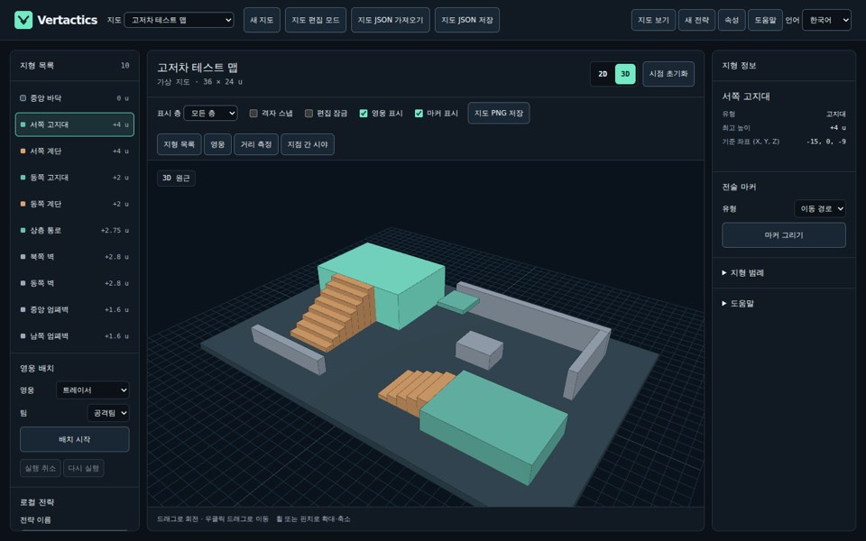

# Vertactics

[한국어](README.ko.md)

**Explore Overwatch tactics in 2D and see the elevation in 3D.**

Vertactics is a map tool for planning approaches, cover, and high-ground positions. Open **Tidal Relay** to plan around a central bridge, a lower drainage route and an elevated maintenance crossing. The catalogue also includes the training maps.

[Open Vertactics](https://oddmash.github.io/Vertactics/)

[See the same workspace in 2D](docs/screenshots/workspace-2d.jpg)

## Explore the map

1. In **2D**, drag to pan and study the terrain layout.
2. In **3D**, drag to orbit and right-drag to pan. Scroll or pinch to zoom in either view.
3. Select a piece of terrain in the map or list to see its coordinates and elevation. The selection carries across both views.

Open **Map catalogue** under map management to browse the 31 maps in the OWKR scrim pool. King’s Row opens the Point A schematic. Entries awaiting terrain are marked in the list.

## Plan a play

Choose a hero and team, then click a walkable surface to place the hero. You can move, rotate, change teams, or delete a placement. Switch views to inspect the same position and elevation from another angle.

In **Tactical markers**, connect waypoints into a route or add a line, circle, area, or note. Use the marker panel to edit points and labels. Routes and markers appear in both views.

Use the editor controls to snap placements to the grid, lock edits, or hide heroes and markers while keeping them in the strategy. Press **Esc** to cancel an active placement. **Ctrl/⌘+Z** undoes an edit, and **Ctrl/⌘+Shift+Z** redoes it.

In **Local strategy**, save the current map and plan under a name. Use the saved-strategy list to reopen, duplicate, or delete plans in the same browser. Save under a new name to keep a separate copy while editing.

Your most recently edited workspace is also saved automatically in this browser. Use **Recover previous work** to reopen it. Named strategies remain available independently.

Use **Strategy files** to transfer the map and strategy together as JSON. **Save map PNG** captures the active map camera.

Create a share link under **Strategy files**. Anyone with the link can view the map or play the timeline. They can make an editable copy in their own browser. For strategies that exceed the link size limit, transfer the JSON file.

## Choose a map

Open **Change map** to browse the Overwatch catalogue by mode. The King’s Row Point A schematic supports planning in 2D and 3D. The catalogue shows the verification status of other maps.

Hold or drag a placed portrait to move it. Drop it on the trash target to remove it. Saved strategies with older map snapshots still reopen from their save or share link.

[Development](development.md) · [Contribution](development.md#contribute) · [Verification](SPEC.md) · [MIT licence](LICENSE)

Vertactics is an unofficial fan project and is unaffiliated with Blizzard Entertainment.
